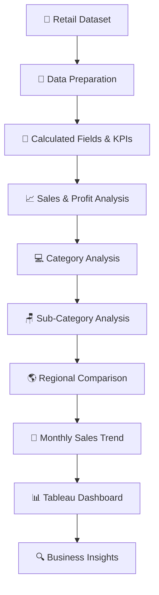
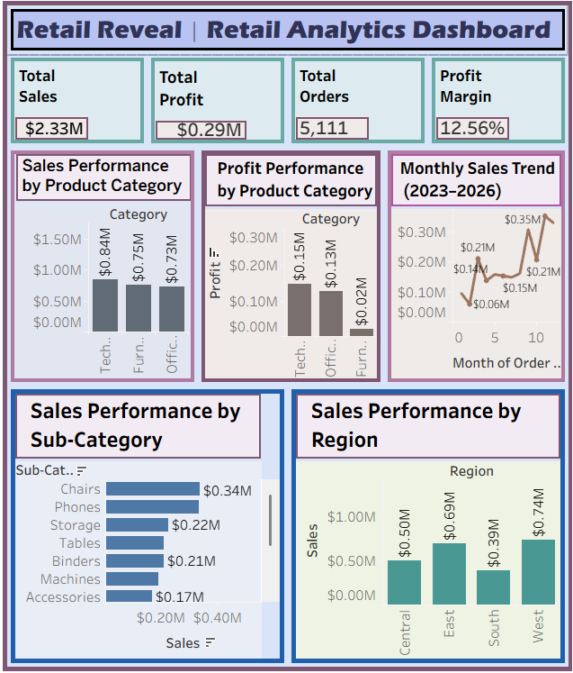
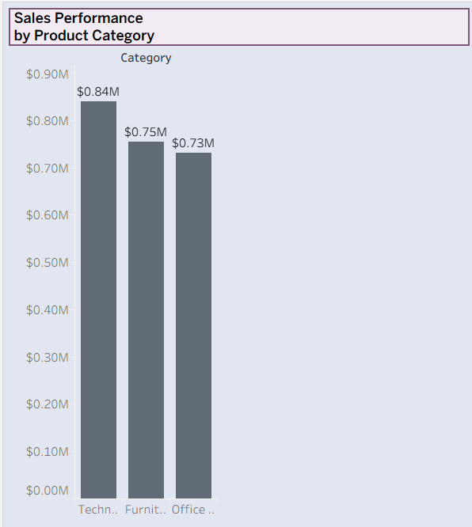
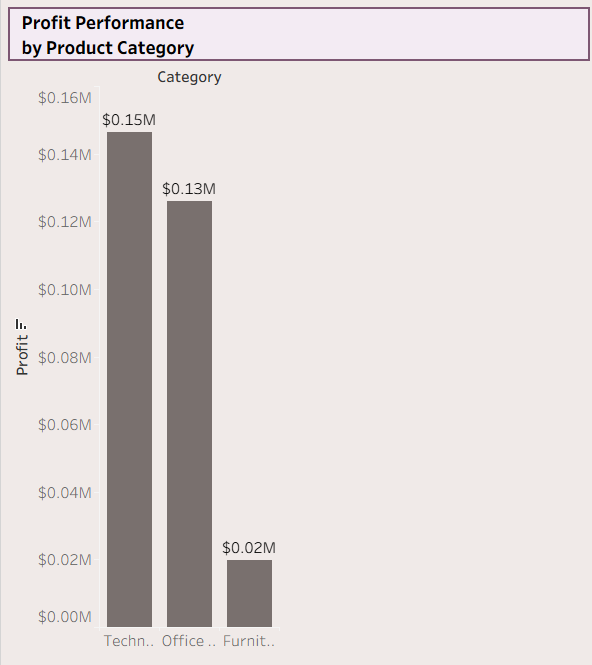
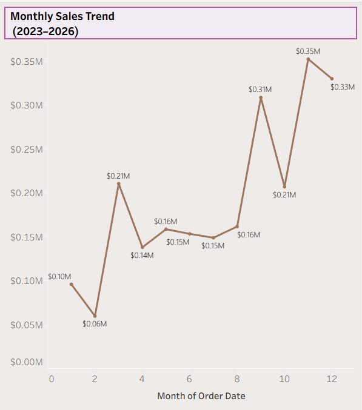
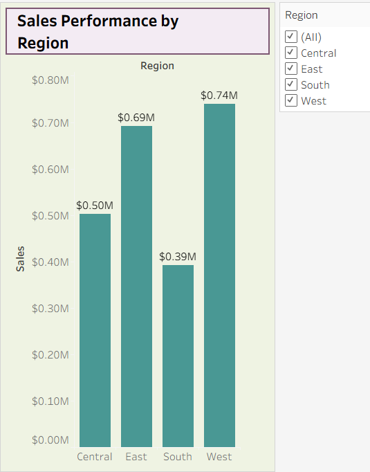
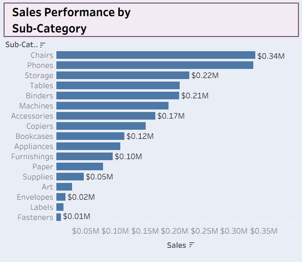

# 📊 Retail Reveal

# Retail Analytics Dashboard

## Transform Data. Reveal Insights. Decide with Confidence. 🛒

See what your sales are saying.

---

<p align="center">


</p>

---

# 📖 Project Description

**Retail Reveal** is an interactive Retail Analytics Dashboard built using **Tableau Public**, designed to transform retail data into meaningful visualizations that make sales performance, profitability, and regional comparisons easier to understand.

Instead of manually reviewing spreadsheets, users can explore KPIs, category performance, sub-category sales, regional comparisons, and monthly sales patterns through a unified dashboard.

Retail Reveal combines KPI creation, calculated fields, category analysis, and regional comparisons into a single analytics experience, making retail performance easier to explore and interpret.

---

# ✨ Key Highlights

- 📊 Retail Analytics Dashboard
- 📈 KPI-Driven Performance Tracking
- 💻 Category & Sub-Category Analysis
- 🌎 Regional Sales Comparison
- 📅 Monthly Sales Trend Exploration
- 🧮 Calculated Fields & Custom Metrics
- 🎨 Dashboard Design & Data Visualization
- ⚡ Built with Tableau Public

---

# 🏗 System Architecture

Retail Reveal follows an analytics workflow that transforms retail data into visual business insights.



---

## 🔄 Application Workflow

1. Load the retail dataset into Tableau Public.
2. Prepare the data for analysis.
3. Create calculated fields and KPIs.
4. Analyze overall sales and profitability.
5. Compare performance across product categories.
6. Explore sub-category sales.
7. Compare sales across regions.
8. Examine monthly sales trends.
9. Present the results through dashboard visualizations.
10. Identify areas for further business investigation.

---

# 📊 Feature Comparison

| Feature | Traditional Spreadsheet Review | Retail Reveal |
|:---|:---:|:---:|
| KPI Tracking | Manual | Dashboard-based |
| Category Analysis | Manual | Visual comparison |
| Sub-Category Analysis | Manual | Visual comparison |
| Regional Comparison | Manual | Visual comparison |
| Sales Trend Analysis | Manual | Monthly visualization |
| Calculated Fields | Formula-based | Tableau calculated fields |
| Dashboard Design | Static reports | Tableau dashboard |
| Interactivity | Depends on spreadsheet setup | Depends on configured dashboard controls |

---

# ✨ Core Features

## 📈 Overall Performance KPIs

- Total Sales
- Total Profit
- Total Orders
- Profit Margin
- At-a-glance performance overview

## 💻 Category Analysis

- Sales by product category
- Profit by product category
- Category-level comparisons
- Identification of areas for further investigation

## 🪑 Sub-Category Analysis

- Sales breakdown by sub-category
- Comparison of product sub-categories
- Identification of higher-sales sub-categories

## 🌎 Regional Performance

- Sales by region
- Regional sales comparisons
- Identification of the highest-sales region
- Opportunities for further regional analysis

## 📅 Sales Trends

- Monthly sales trend visualization
- Time-based sales comparisons
- Exploration of changes in sales over time

---

# 📌 Dashboard Metrics

| KPI | Value |
|:---|---:|
| Total Sales | $2.33M |
| Total Profit | $292.30K |
| Total Orders | 5,111 |
| Profit Margin | 12.56% |


---

# 🛠 Technology Stack

| Layer | Technology |
|:---|:---|
| Visualization Platform | Tableau Public |
| Data Source | Retail Sales Dataset |
| Analytics | Sales & Profitability Analysis |
| Calculated Metrics | Tableau Calculated Fields |
| Dashboard Design | Tableau Dashboard |
| Deployment | Tableau Public |

---

# 📂 Project Structure

```text
RETAIL-REVEAL-RETAIL-ANALYTICS-DASHBOARD/
│
├── README.md
│
├── data/
│   └── retail_sales_dataset.csv
│
├── dashboard/
│   └── RetailAnalyticsDashboard.twbx
│
├── screenshots/
│   ├── dashboard-overview.png
│   └── dashboard-details.png
│
└── insights/
    └── key-findings.md
```


---

# 📸 Application Preview

**Explore the published dashboard:**

[](https://public.tableau.com/views/P1_17919139458500/RetailAnalyticsDashboard)

[**Open Retail Reveal on Tableau Public →**](https://public.tableau.com/views/P1_17919139458500/RetailAnalyticsDashboard)









---

# ⚙️ Access the Dashboard

## Prerequisites

- A modern web browser
- An internet connection

No local Tableau installation is required to view the published dashboard.

### Open the Dashboard

Visit:

https://public.tableau.com/views/P1_17919139458500/RetailAnalyticsDashboard

---

# 🚀 Demo Workflow

| Step | Action |
|:---:|:---|
| 1 | Open the Tableau Public dashboard |
| 2 | Review the overall KPIs |
| 3 | Compare category-level sales and profit |
| 4 | Explore sub-category sales |
| 5 | Compare regional sales |
| 6 | Review the monthly sales trend |
| 7 | Use available filters, if configured |
| 8 | Identify patterns and questions for further analysis |

---

# 🌟 Why Retail Reveal?

Retail Reveal uses Tableau's visualization capabilities to make retail performance easier to explore and understand.

The dashboard brings together key metrics, category comparisons, sub-category sales, regional performance, and monthly trends in one place.

It also demonstrates an important analytical principle: visual patterns can highlight areas worth investigating, but understanding the reasons behind those patterns requires deeper analysis.

**Retail Reveal doesn't just display data — it helps reveal the questions behind the numbers.**

---

# 🔮 Future Enhancements

| Phase | Planned Feature |
|:---|:---|
| Phase 1 | Customer Segmentation Analysis |
| Phase 2 | Predictive Sales Forecasting |
| Phase 3 | Profitability Analysis |
| Phase 4 | Product-Level Drill-Down |
| Phase 5 | Live Data Integration |
| Phase 6 | Automated Insight Generation |
| Phase 7 | Mobile-Optimized Dashboard |

---

# 🚀 Potential Applications

- 🛒 Retail Performance Monitoring
- 📊 Business Intelligence Reporting
- 💼 Sales Performance Analysis
- 🎓 Analytics Learning & Portfolio Development
- 🏢 Business Decision Support
- 📈 Sales Trend Exploration
- 🌎 Regional Performance Benchmarking

---

# 🎯 Project Benefits

- Clear presentation of retail KPIs
- Simplified sales and profitability comparisons
- Visual category and regional analysis
- Monthly trend exploration
- Centralized dashboard experience
- Accessible through Tableau Public
- No installation required for dashboard viewers

---

# 🛣 Roadmap

- ✅ Retail Analytics Dashboard
- ✅ KPI Creation & Calculated Fields
- ✅ Category Analysis
- ✅ Sub-Category Analysis
- ✅ Regional Comparison
- ✅ Monthly Sales Trend
- 🔄 Predictive Forecasting
- 🔄 Customer Segmentation
- 🔄 Automated Insight Generation
- 🔄 Live Data Integration

---

# 👩‍💻 Developer

## Keya Das

**MCA Graduate | Artificial Intelligence & Data Science**

🌐 **GitHub:**  
https://github.com/Keya3639

📧 **Email:**  
keyakarunamoydas@gmail.com

---

# 🙏 Acknowledgements

This project was developed using:

- 📊 Tableau Public
- 🛒 Retail Sales Dataset
- 🌍 Open-Source Learning Resources

---

<div align="center">

# 📊 Retail Reveal

### Transform Data. Reveal Insights. Decide with Confidence. 🛒

**Built with ❤️ using Tableau Public**

**Data Analytics • Data Visualization • Business Intelligence**

</div>
